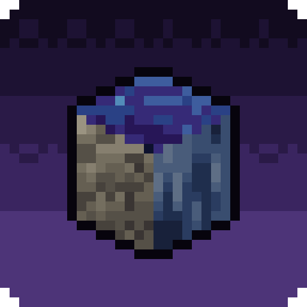
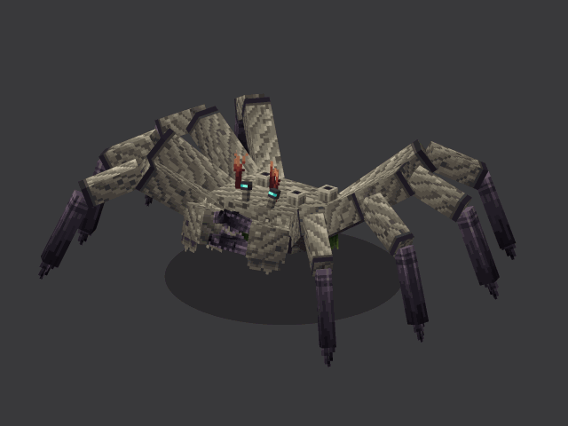
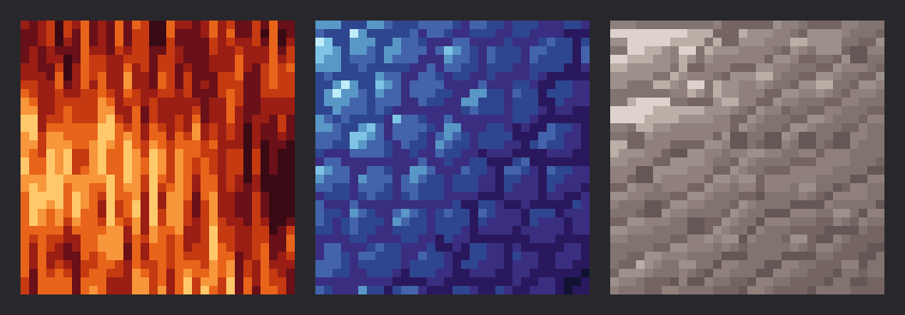
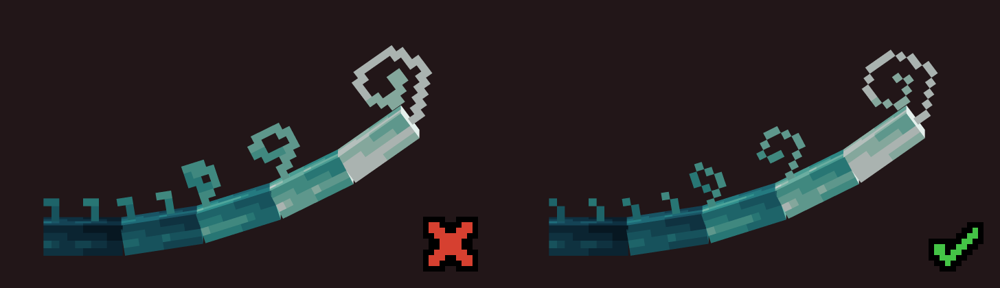
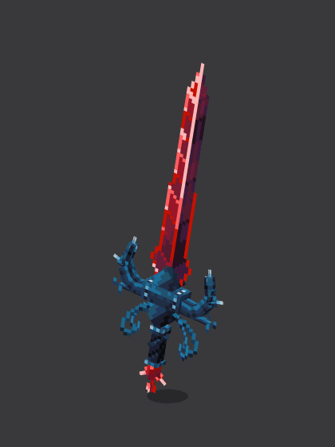
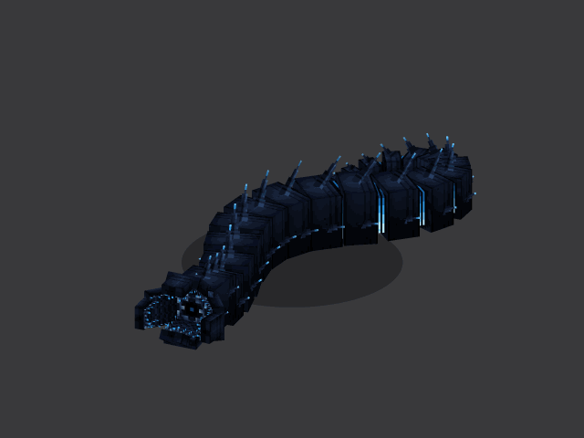
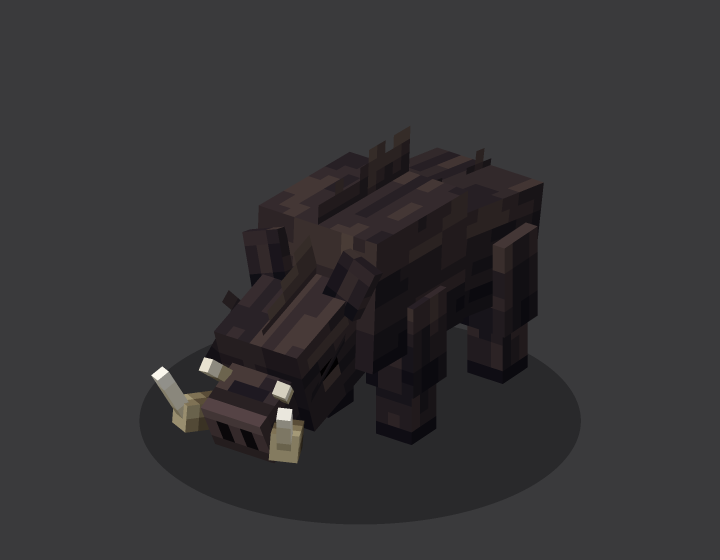
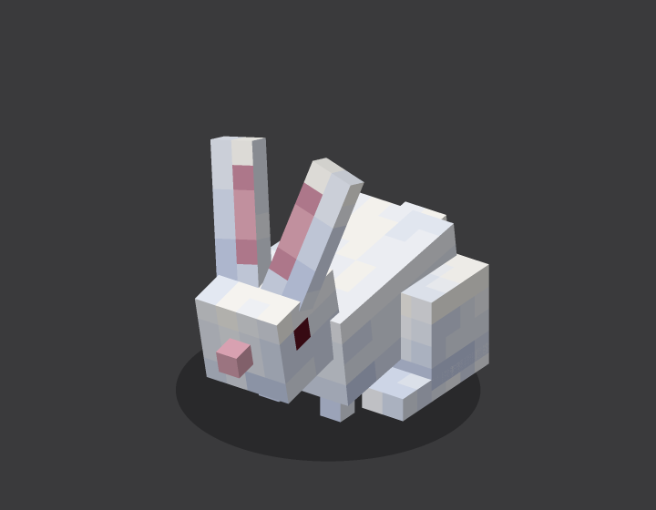
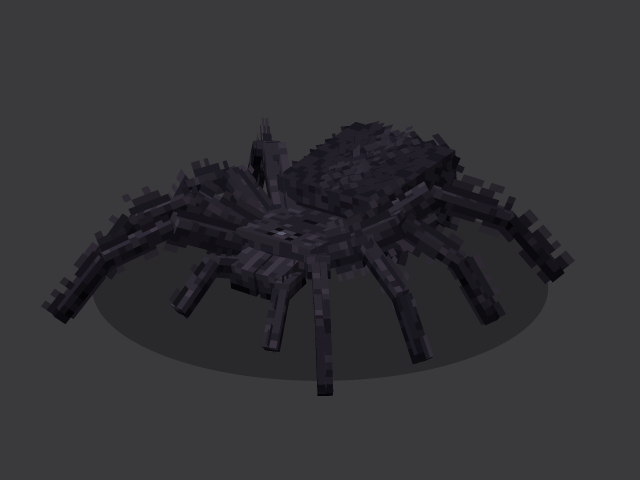

# 3dixel

3dixel is a Claude Code skill for Blockbench-style things. It holds the rules we found while building them: how many cubes a mob needs, when hair belongs in the texture and when on cards, how to keep one pixel size across the model, and why the side view shows most posture mistakes.

## Textures

## Pixel perfect

## Examples

